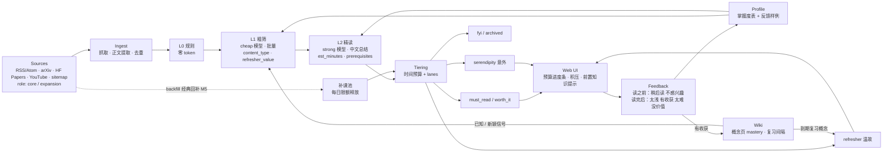

# 架构设计（初版，M0）

> 本文是初版草案，各 milestone 结束时同步更新。偏离计划的取舍见 `docs/decisions/`（掌握度 / 温故见 ADR 0003，时间预算见 ADR 0004）。

## 目标

从用户信任的信源自动采集内容 → LLM 分层过滤与总结 → 在每日时间预算内按 lane 推送到本地 Web UI（新进展 + 温故回炉 + 意外）→ 用户反馈驱动个性化 → "学了"的内容编译进知识 wiki → wiki 反过来为过滤层提供"已知 / 新颖 / 该复习了"信号，形成闭环。

## 数据流



## 各层职责

| 层 | 职责 | 是否用 LLM |
|---|---|---|
| Sources | 读 `config/sources.yaml`：信源类型（rss / arxiv / hf_papers / youtube / sitemap，sitemap 见 ADR 0012）、地址 / 检索式、trust、role（core / expansion）、标签、时间窗、backfill | 否 |
| Ingest | 抓取（`net.py`：httpx，超时 / 重试 / 礼貌 UA / 按 host 限速；信源间线程池并发）、正文提取（HTML / PDF / 字幕）、URL 规范化 + content hash 去重（`urls.py`），由 `ingest.py` 编排写入 `items`；backfill 信源抓历史归档进补课池（M5）。见 ADR 0005 | 否 |
| L0 规则 | 时间窗、include / exclude 关键词、最短长度、已处理跳过 | 否 |
| L1 粗筛 | cheap 模型批量打分：`relevance / novelty / quality`、`content_type`、`refresher_value`、`topics[]` + 一句理由；结合 profile 掌握度：不扎实领域的好讲解加 refresher_value，扎实领域只推 frontier；分数 × trust 取 top-N | 是（判断） |
| L2 精读 | strong 模型读截断全文，输出中文 `tldr / key_points / why_for_you / scores`，以及 `est_minutes`（读懂并验证的时间）和 `prerequisites[]` | 是（判断 + 总结） |
| Tiering | 以 `daily_budget_minutes` 为主约束、各 lane 条数为上限，分到 `must_read / worth_it / refresher / serendipity / fyi / archived`；标记"深读"并可顺延；积压超期降级；允许为空 | 否 |
| Web UI | 本地 FastAPI + Jinja2 + HTMX：今日 digest（按 lane）、预算进度条、积压数量、est_minutes、前置知识提示、详情、历史、反馈按钮；稍后再看、运维（立即运行、用量、trust 建议）、信源管理、wiki 体检与知识图谱（M7） | 否 |
| Feedback | 文章反馈两组（读之前 / 读完后，ADR 0013），每条目只有一个当前状态；供 few-shot、profile 证据、信源 trust 与 wiki 队列；掌握度只在概念复习中调整 | 否 |
| Profile | 用户手写的 `profile.md`，含可解析的领域掌握度表；LLM 只提出修改 diff（含掌握度调整建议），用户确认后才写入 | 提案时用 |
| Wiki | "学了"的条目由 LLM 产出结构化页面操作、代码落盘；概念页记录 mastery 与复习间隔；`index.md` 作为已知知识注入 L1，到期概念进入温故栏 | 是（结构化输出） |

## 掌握度、温故与前置知识（ADR 0003）

- 掌握度四级：`陌生 / 接触过 / 想回炉（熟悉但不扎实）/ 扎实`。"熟悉"不等于"扎实"：只有"扎实"领域才降低入门讲解的权重。
- refresher lane 独立于 must_read，默认 1–2 条 / 天，来源：L1 中 refresher_value 高的 explainer / survey、M6 到期复习的概念（若有讲该概念的好文一起推）、M5 的经典回补池。
- L2 的 `prerequisites[]` 命中用户不扎实的概念时，UI 提示"建议先回炉：[[概念]]"。
- 复习调度（M6）：SM-2 简化版，按钮"还记得 / 模糊 / 忘了"调整 interval 与 mastery。

## 每日时间预算（ADR 0004）

- `daily_budget_minutes`（默认 105）为主约束；`lanes` 中的条数为上限。
- 单条 `est_minutes` > 预算 × `deep_read_ratio`（默认 0.6）标"深读"，可顺延到预算有余的日子。
- 未读 must_read 计入积压并在 UI 显示；超过 `backlog_max_days`（默认 3）天降级到 fyi。

## 流水线细节（M2，见 ADR 0006）

**L0**（`pipeline/l0_rules.py`）：只处理 `items.status = new`；排除超出 `filter.l0.max_age_days`、正文短于 `min_content_chars`、标题 / 摘要命中 `exclude_keywords`（或 `include_keywords` 非空却未命中）的条目，排除原因写入 `assessments`（stage = L0）。

**L1 候选**：`sb run --limit N` 限制送入 L1 的条目数。按信源轮询选取（信源按 trust 降序，信源内由新到旧），避免高产信源占满名额。每批 `filter.l1.batch_size` 条，system 前缀为 profile + 规则，固定不变以利用缓存。

**排序分**（参数在 `filter.score`）：

```
score = (w_rel·relevance + w_q·quality + w_v·max(novelty, refresher_value)) / (w_rel + w_q + w_v)
        × (1 + trust_weight·(trust − 3))
```

默认 w_rel = 0.45、w_q = 0.30、w_v = 0.25、trust_weight = 0.1。`max(novelty, refresher_value)` 让条目因"新"或"值得回炉"都能得分。有 L2 结果时用 L2 的 scores，否则用 L1 的。

**L2 选择**（`filter.l1.top_n`，默认 15）：先预留意外栏候选（高质量且低相关，或 role = expansion，按 quality 取 `lanes.serendipity` 条）和温故栏候选（explainer / survey / tutorial 且 refresher_value ≥ 阈值，按 refresher_value 取 `lanes.refresher` 条），其余 core 条目按排序分补满。L2 前按字符数预估费用，若超过 `run.max_cost_usd` 则停止，不调用 L2、不分级。

**L2 输入**：论文（arXiv HTML / PDF）按标题切出 abstract + introduction + conclusion，每节不超过 `filter.l2.section_max_chars`；找不到章节或非论文时取正文开头；总长不超过 `filter.l2.max_input_chars`。

**分级**（`pipeline/tiering.py`，纯函数）：

- 只有经过 L2 的条目能进前排 lane（must_read / refresher / serendipity / worth_it）。
- 资格：refresher 类型（explainer / survey / tutorial、refresher_value ≥ 阈值且 ≥ novelty）只进温故栏，不占必读名额；否则 score ≥ `thresholds.must_read` 且 relevance ≥ `must_read_relevance` 可进必读；quality ≥ `serendipity_quality` 且 relevance ≤ `serendipity_max_relevance` 可进意外；score ≥ `worth_it` 可进值得读。role = expansion 的条目只能进意外栏。
- 预算分配：先放此前顺延的深读条目，再按 must_read → refresher → serendipity → worth_it 的顺序、分数从高到低填充；每条须放得进剩余预算，lane 条数不超过 `lanes`。
- 放不下的深读条目（est_minutes > 预算 × `deep_read_ratio`）记为 `deferred`，下次 run 优先；顺延超过 `backlog_max_days` 天不再顺延，进 fyi。放不下的非深读条目进 fyi。
- 其余条目 score ≥ `thresholds.fyi` 进 fyi，否则 archived。
- 积压：此前各日仍未读（`items.read_at` 为空；M7 起由读完后的四种反馈写入）、且当前状态不是稍后读 / 不感兴趣的 must_read，超过 `backlog_max_days` 天的改为 fyi；未超期的计入积压数。
- 预算预留（ADR 0007）：`lane_budget_reserve`（默认 refresher 15、serendipity 10 分钟）在分配开始时为有合格候选的温故 / 意外栏保留，must_read 与 worth_it 不能占用；该栏分配结束后未用完的额度释放回总预算。
- 同一天多次 `sb run` 共享当日预算：后一次 run 先扣除当天已占用的名额与时间（预期行为，不会每次 run 都重新给满 105 分钟）。digest 日期用本地日期，高峰计价用 UTC。

**未经 L2 的阅读时间估计**：`正文字符数 / estimate.chars_per_minute`，论文 × `paper_multiplier`，限制在 `[min_minutes, max_minutes]`。

**items.status**：`new → l0_rejected | l1 → l2 → tiered | deferred`；回补条目 `new → backfill_l1 → l2 → tiered | deferred`（没排上的回到 `backfill_l1`）。

## Web UI（M3）

- `web/app.py`（FastAPI + Jinja2，服务端渲染）：`/` 当天（或 `?date=`）digest，按 必读 / 温故 / 意外 / 值得读 / 顺延深读 / 速览（折叠）分组，顶部预算进度条（`data-budget="已排/预算"`）与积压数；`/item/{id}` 详情（L1 / L2 评分、key points、反馈历史）；`/history` 日期列表。
- 反馈：HTMX 按钮 `POST /feedback`（item_id、kind、可选 note），返回按钮组片段原地替换；kind 白名单，非法 400，条目不存在 404。M7 起为两组按钮，最新一次点击即当前状态，再点高亮按钮撤销（见下文"文章反馈与运维"）。
- "建议先回炉"：L2 的 `prerequisites` 中出现在用户掌握度为 陌生 / 接触过 / 想回炉 的领域（领域名或说明）里的概念单独提示（`profile/loader.weak_prerequisites`）。
- 前端资源 vendored 在 `web/static/`，不依赖 CDN：
  - HTMX 2.0.4，来源 `https://unpkg.com/htmx.org@2.0.4/dist/htmx.min.js`，sha256 `e209dda5c8235479f3166defc7750e1dbcd5a5c1808b7792fc2e6733768fb447`；
  - Cytoscape.js 3.34.4（M7），来源 `https://registry.npmjs.org/cytoscape/-/cytoscape-3.34.4.tgz` 中的 `package/dist/cytoscape.min.js`，sha256 `081591ab735b2b6a3b31a3c60f8f3a3e2fee8c92939e0c7820ad1208571b6cd8`，MIT。
- `sb serve` 默认只监听 127.0.0.1。
- 定时：`sb schedule install` 生成 launchd plist（`uv run sb run`，默认本地 07:00，按 UTC 检查是否高峰）。

## 个性化（M4，见 ADR 0008）

- `profile/feedback.py`：汇总近 `personalize.feedback_window_days` 天各条目的当前反馈（M7：不感兴趣 / 太浅 / 有收获 / 太难 / 没价值；含条目标题、信源、content_type、topics）。
- L1 system prompt = profile + 规则（固定前缀）+ "最近反馈样例"（M7：正例有收获、反例不感兴趣 / 没价值、校准样例太浅 / 太难，各最多 `few_shot_per_polarity` 条，无反馈时省略）；近期"太难"条目的前置知识放在 user 消息开头。
- `sb profile update`（与 Web `/profile` 共用 `profile/rewrite.py`）：strong 模型输出结构化提案（掌握度表的 update / add / remove，段落的 append / remove，每条带反馈 id 证据）→ 代码按规则校验（M7：升级需要太浅，有收获只能用于 陌生 → 接触过，降级需要太难，每次最多一级）→ 生成新文本与 unified diff；`--apply` 前备份到 `data/profile_history/`。反馈不足时不调用 LLM。LLM 用量记为 stage = PROFILE。
- `sb sources tune`（`profile/tune.py`）：每个条目取当前反馈（M7：有收获为正，不感兴趣 / 没价值为负），按信源统计正向比例，样本足够时建议 trust ±1；`--apply` 对 `config/sources.yaml` 做行级替换（不存在时从 example 复制）。

## 视频、长内容与回补（M5，见 ADR 0009）

- YouTube：频道 RSS → 字幕（youtube-transcript-api，失败退回 yt-dlp，只取字幕）→ 每约 30 秒一段、段首 `[mm:ss]` 的文本存入 `content`；时长取字幕末尾，存 `duration_seconds`。L0 排除 Shorts 与过短视频；无字幕视频只经 L1、不进 L2。视频要点带时间戳，展示时生成 `watch?v=ID&t=秒` 链接。
- 长内容：待读文本 > `filter.l2.mapreduce_threshold_chars` 时分块 → cheap 模型逐块提要（stage L2_MAP，prompt `l2_map_system.md`）→ strong 模型汇总（stage L2）。
- 按需精读：`sb deep` / Web "精读"按钮（`pipeline.run.deep_one`），只写 L2 评估、不改 digest。
- 回补：`backfill: true` 信源在 fetch 时把时间窗外的历史条目存为 `is_backfill = 1`；每次 run 在常规 L2 之后，从回补池（L1 粗筛后状态 `backfill_l1`）按优先级挑 `backfill.daily_limit` 条做 L2，分级时只能进温故栏，没排上的回到池中。

## 知识 wiki 与复习（M6，见 ADR 0010）

- 布局：`data/wiki/index.md`（代码重建）、`log.md`（只追加）、`pages/{concepts,entities,papers}/<slug>.md`（frontmatter + `[[slug]]`），原文在 `data/wiki/raw/<item_id>.md`（M7 起；页面链接 `../../raw/<id>.md`，lint / index / 图谱忽略 raw/）。
- ingest：条目 L2 结果 + 正文（长文只给要点）+ index + 相关页面 → strong 模型输出 `WikiPlan`（create，或 update 的 append_section / replace_section / add_links / add_aliases）→ 代码校验 slug 与路径、落盘、重建 index、追加 log（stage = WIKI）。
- 复习：SM-2 简化版（还记得 / 模糊 / 忘了，见 ADR 0010；M7 增加 需要回炉 / 已扎实），状态写在概念页 frontmatter。新概念页 mastery 从"接触过"起步（M7，不继承 profile）。
- 闭环：
  - 到期概念：作为只进温故栏的候选参与分级（est 5 分钟，`digest_concepts` 表，附近期相关条目）；
  - L1：user 消息开头附与本批相关的"已知知识"（system 前缀不变）；
  - 前置知识：匹配到不扎实的概念页时，"建议先回炉"链接到 wiki。

## 文章反馈与运维（M7，见 ADR 0013）

- 反馈两组：
  - 读之前：`later` 稍后读、`dismiss` 不感兴趣；
  - 读完后：`too_easy` 太浅、`gained` 有收获、`too_hard` 太难、`worthless` 没价值。
- 条目的当前状态 = 最新一条 feedback（`clear` = 撤销）。读完后四种写 `read_at`，其余清空 `read_at`。`/later` 列出当前为稍后读的条目。
- `ops.py`：`run_once`（与 `sb run` 相同，持有 `data/run.lock` 的非阻塞 `fcntl.flock`）、`ingest_items`、`apply_trust`，由 CLI 与 Web 共用。
- `web/tasks.py`：后台线程任务，同类只跑一个；状态片段 `GET /tasks/<kind>` 每 2 秒轮询。
- 页面：
  - `/`："待编进 wiki" 按钮；
  - `/ops`：用量、立即运行、trust 建议；
  - `/sources`：列表、试抓、添加、启停、删除确认；写 `config/sources.yaml`，原子写，注释不保留；
  - `/wiki`：体检按钮；
  - `/wiki/graph` 与 `/wiki/graph.json`：节点 = 页面，边 = 已存在页面间的 wikilink。

## 数据模型草案

存储：SQLite 单文件 `data/brain.db`；wiki 为 `data/wiki/` 下的 Markdown。字段为草案，以实现时的 `db.py` 为准（M1 实现 `sources`、`items`，M2 实现 `assessments`、`digests`、`llm_calls`，M3 实现 `feedback` 与 `items.read_at`；schema 版本记录在 `PRAGMA user_version`）。

| 表 | 主要字段 | 引入 |
|---|---|---|
| `sources` | `id`, `type`, `url` / `query`, `trust`, `role`（core / expansion）, `tags`, `max_age_days`, `enabled`, `backfill`；`last_fetch_at / status / added / message`（最近一次抓取，M7） | M1（`last_fetch_*` M7，schema v6） |
| `items` | `id`, `source_id`, `url`, `url_canonical`（唯一）, `content_hash`, `title`, `author`, `summary`, `content`, `extract_method`（feed / html / arxiv_html / pdf / summary / none / transcript / transcript_ytdlp / no_transcript）, `published_at`, `fetched_at`, `status`, `read_at`, `is_backfill`, `duration_seconds` | M1（`read_at` M3，`is_backfill` / `duration_seconds` M5） |
| `assessments` | `id`, `item_id`, `stage`（L0 / L1 / L2）, `model`, `data`（JSON：L0 `reason`；L1 `relevance / novelty / quality / content_type / refresher_value / topics / one_line_reason`；L2 `tldr / key_points / why_for_you / est_minutes / prerequisites / scores`）, `score`（排序分）, `created_at` | M2 |
| `digests` | `date`（本地日期）, `item_id`, `lane`（must_read / worth_it / refresher / serendipity / fyi / archived / deferred）, `rank`, `est_minutes`, `is_deep_read`, `deferred_from`（首次顺延日期）, `created_at`；`(date, item_id)` 唯一 | M2 |
| `feedback` | `id`, `item_id`, `kind`（M7：later / dismiss / too_easy / gained / too_hard / worthless / clear）, `note`, `ts`；每个条目最新一条为当前状态；读完后四种写 `items.read_at` | M3（kind 取值 M7 修订） |
| `wiki_ingests` | `item_id`（主键）, `ts`, `pages`（JSON：新建 / 更新的 slug） | M6 |
| `digest_concepts` | `date`, `slug`, `title`, `mastery`, `est_minutes`, `related_item_id`, `created_at`；`(date, slug)` 唯一 | M6 |
| `llm_calls` | `id`, `ts`, `backend`, `stage`（L1 / L2 / L2_MAP / PROFILE / WIKI）, `model`, `prompt_tokens`, `cache_hit_tokens`, `cache_miss_tokens`, `completion_tokens`, `cost_usd`（按 config 价格估算，非高峰 × `off_peak_multiplier`）, `is_peak` | M2 |

Wiki 概念页 frontmatter（M6）：`mastery`、`last_reviewed`、`interval_days`、`ease`（SM-2 简化版）、`sources`（来源条目）。

## LLM 后端

统一接口（M2）：`complete_json(messages, schema, tier="cheap"|"strong") -> (obj, usage)`。默认 DeepSeek（OpenAI 兼容），`fake` 后端用于离线测试。模型名、价格、预算与配额都写在 `config/settings.yaml`，便于更换。见 ADR 0002。

- 模型分工：cheap 用于 L1 粗筛与长内容分块提要（L2_MAP）；strong 用于 L2 精读、按需精读、wiki ingest、profile 修改提案。两级机制保留，默认两级都用 `deepseek-flash`（ADR 0014）；在 `llm.models.strong` 中可改回 `deepseek-v4-pro`。

- DeepSeek（`llm/deepseek.py`）：openai SDK，`response_format={"type": "json_object"}`，prompt 中含 json 示例；网络错误 / 429 / 5xx 由 SDK 指数退避重试（`llm.max_retries`）；输出用 pydantic 校验，失败重试一次；错误信息中的密钥被替换为 `***`。
- fake（`llm/fake.py`）：按标题关键词（内置 AI infra 关键词 ∪ profile 中的英文词）与标题哈希确定性打分，离线全链路可产出各 lane。
- 输出健壮性（ADR 0011）：推理模型（如 deepseek-v4-pro）的推理 token 计入 `max_tokens`（strong 默认 8192，对 flash 同样适用）；校验失败时重试一次，截断（finish_reason = length）时 `max_tokens` 翻倍（上限 `max_tokens_cap`），并把字段路径级的错误反馈给模型；WikiPlan 宽容解析，单个非法操作只丢弃该操作。
- prompts 在 `src/secondbrain/llm/prompts/*.md`，`{profile}` 与 `{mastery}` 在运行时替换；掌握度表解析失败时提示模型直接参考画像全文。

## 借鉴的原则

- **确定性预过滤**：能用规则解决的（时间窗、关键词、长度、去重）不花 token。
- **LLM 只做判断**：抓取、去重、排序、分级、落盘都是确定性代码；LLM 只输出结构化的打分、理由、估时和总结。
- **推荐必带理由**：每条推荐都有 `one_line_reason` / `why_for_you`，可解释、可反馈。
- **允许空**：某天没有值得推荐的内容就不推，配额与预算是上限而不是目标。
- **意外名额**：保留少量"高质量但低相关"的名额（`lanes.serendipity`，候选含 `role: expansion` 信源），防止信息茧房。
- **熟悉 ≠ 掌握**：不扎实的基础知识值得回炉，用独立的温故栏承载，不与新进展抢名额。
