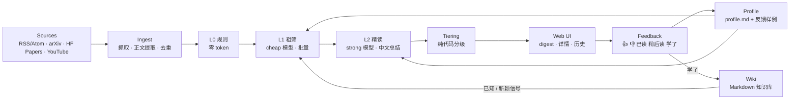

# 架构设计（初版，M0）

> 本文是初版草案，各 milestone 结束时同步更新。偏离计划的取舍见 `docs/decisions/`。

## 目标

从用户信任的信源自动采集内容 → LLM 分层过滤与总结 → 按推荐等级推送到本地 Web UI → 用户反馈驱动个性化 → "学了"的内容编译进知识 wiki → wiki 反过来为过滤层提供"已知 / 新颖"信号，形成闭环。

## 数据流

## 各层职责

| 层 | 职责 | 是否用 LLM |
|---|---|---|
| Sources | 读 `config/sources.yaml`：信源类型、地址 / 检索式、trust、标签、时间窗 | 否 |
| Ingest | 抓取（httpx，超时 / 重试 / 礼貌 UA）、正文提取（HTML / PDF / 字幕）、URL 规范化 + content hash 去重，写入 `items` | 否 |
| L0 规则 | 时间窗、include / exclude 关键词、最短长度、已处理跳过 | 否 |
| L1 粗筛 | cheap 模型批量打分：`relevance / novelty / quality` + 一句理由；profile 放 system 前缀以利用缓存；分数 × trust 取 top-N | 是（判断） |
| L2 精读 | strong 模型读截断全文，输出中文 `tldr / key_points / why_for_you / scores` | 是（判断 + 总结） |
| Tiering | 综合分 → `must_read / worth_it / fyi / archived`，配额可配、允许为空、保留意外名额 | 否 |
| Web UI | 本地 FastAPI + Jinja2 + HTMX：今日 digest、详情、历史、反馈按钮 | 否 |
| Feedback | 记录用户动作，供 profile 汇总与 few-shot | 否 |
| Profile | 用户手写的 `profile.md`；LLM 只提出修改 diff，用户确认后才写入 | 提案时用 |
| Wiki | "学了"的条目由 LLM 产出结构化页面操作、代码落盘；`index.md` 作为已知知识注入 L1 | 是（结构化输出） |

## 数据模型草案

存储：SQLite 单文件 `data/brain.db`；wiki 为 `data/wiki/` 下的 Markdown。字段为草案，以实现时的 `db.py` 为准。

| 表 | 主要字段 | 引入 |
|---|---|---|
| `sources` | `id`, `type`, `url` / `query`, `trust`, `tags`, `max_age_days`, `enabled` | M1 |
| `items` | `id`, `source_id`, `url`, `url_canonical`（唯一）, `content_hash`, `title`, `author`, `summary`, `content`, `published_at`, `fetched_at`, `status` | M1 |
| `assessments` | `id`, `item_id`, `stage`（L1 / L2）, `model`, `relevance`, `novelty`, `quality`, `reason`, `tldr`, `key_points`（JSON）, `why_for_you`, `created_at` | M2 |
| `digests` | `date`, `item_id`, `tier`, `rank`, `is_serendipity` | M2 |
| `feedback` | `id`, `item_id`, `kind`（up / down / read / later / learned）, `ts`, `note` | M3 |
| `llm_calls` | `id`, `ts`, `backend`, `model`, `stage`, `input_tokens`, `cache_hit_tokens`, `output_tokens`, `cost_usd`（按 config 价格估算） | M2 |

## LLM 后端

统一接口（M2）：`complete_json(messages, schema, tier="cheap"|"strong") -> (obj, usage)`。默认 DeepSeek（OpenAI 兼容），`fake` 后端用于离线测试。模型名、价格、配额都写在 `config/settings.yaml`，便于更换。见 ADR 0002。

## 借鉴的原则

- **确定性预过滤**：能用规则解决的（时间窗、关键词、长度、去重）不花 token。
- **LLM 只做判断**：抓取、去重、排序、分级、落盘都是确定性代码；LLM 只输出结构化的打分、理由和总结。
- **推荐必带理由**：每条推荐都有 `one_line_reason` / `why_for_you`，可解释、可反馈。
- **允许空**：某天没有值得推荐的内容就不推，配额是上限而不是目标。
- **意外名额**：保留少量"高质量但低相关"的名额（`serendipity_slots`），防止信息茧房。
