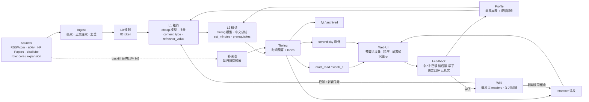

# 架构设计（初版，M0）

> 本文是初版草案，各 milestone 结束时同步更新。偏离计划的取舍见 `docs/decisions/`（掌握度 / 温故见 ADR 0003，时间预算见 ADR 0004）。

## 目标

从用户信任的信源自动采集内容 → LLM 分层过滤与总结 → 在每日时间预算内按 lane 推送到本地 Web UI（新进展 + 温故回炉 + 意外）→ 用户反馈驱动个性化 → "学了"的内容编译进知识 wiki → wiki 反过来为过滤层提供"已知 / 新颖 / 该复习了"信号，形成闭环。

## 数据流



## 各层职责

| 层 | 职责 | 是否用 LLM |
|---|---|---|
| Sources | 读 `config/sources.yaml`：信源类型、地址 / 检索式、trust、role（core / expansion）、标签、时间窗、backfill | 否 |
| Ingest | 抓取（`net.py`：httpx，超时 / 重试 / 礼貌 UA / 按 host 限速；信源间线程池并发）、正文提取（HTML / PDF / 字幕）、URL 规范化 + content hash 去重（`urls.py`），由 `ingest.py` 编排写入 `items`；backfill 信源抓历史归档进补课池（M5）。见 ADR 0005 | 否 |
| L0 规则 | 时间窗、include / exclude 关键词、最短长度、已处理跳过 | 否 |
| L1 粗筛 | cheap 模型批量打分：`relevance / novelty / quality`、`content_type`、`refresher_value`、`topics[]` + 一句理由；结合 profile 掌握度：不扎实领域的好讲解加 refresher_value，扎实领域只推 frontier；分数 × trust 取 top-N | 是（判断） |
| L2 精读 | strong 模型读截断全文，输出中文 `tldr / key_points / why_for_you / scores`，以及 `est_minutes`（读懂并验证的时间）和 `prerequisites[]` | 是（判断 + 总结） |
| Tiering | 以 `daily_budget_minutes` 为主约束、各 lane 条数为上限，分到 `must_read / worth_it / refresher / serendipity / fyi / archived`；标记"深读"并可顺延；积压超期降级；允许为空 | 否 |
| Web UI | 本地 FastAPI + Jinja2 + HTMX：今日 digest（按 lane）、预算进度条、积压数量、est_minutes、前置知识提示、详情、历史、反馈按钮 | 否 |
| Feedback | 记录用户动作（含"需要回炉 / 已扎实"），供 profile 汇总、掌握度调整与 few-shot | 否 |
| Profile | 用户手写的 `profile.md`，含可解析的领域掌握度表；LLM 只提出修改 diff（含掌握度调整建议），用户确认后才写入 | 提案时用 |
| Wiki | "学了"的条目由 LLM 产出结构化页面操作、代码落盘；概念页记录 mastery 与复习间隔；`index.md` 作为已知知识注入 L1，到期概念进入温故栏 | 是（结构化输出） |

## 掌握度、温故与前置知识（ADR 0003）

- 掌握度四级：`陌生 / 接触过 / 想回炉（熟悉但不扎实）/ 扎实`。"熟悉"不等于"扎实"：只有"扎实"领域才降低入门讲解的权重。
- refresher lane 独立于 must_read，默认 1–2 条 / 天，来源：L1 中 refresher_value 高的 explainer / survey、M6 到期复习的概念（若有讲该概念的好文一起推）、M5 的经典回补池。
- L2 的 `prerequisites[]` 命中用户不扎实的概念时，UI 提示"建议先回炉：[[概念]]"。
- 复习调度（M6）：SM-2 简化版，按钮"还记得 / 模糊 / 忘了"调整 interval 与 mastery。

## 每日时间预算（ADR 0004）

- `daily_budget_minutes`（默认 105）为主约束；`lanes` 中的条数为上限。
- 单条 `est_minutes` > 预算 × `deep_read_ratio`（默认 0.6）标"深读"，可顺延到预算有余的日子。
- 未读 must_read 计入积压并在 UI 显示；超过 `backlog_max_days`（默认 3）天降级到 fyi。

## 流水线细节（M2，见 ADR 0006）

**L0**（`pipeline/l0_rules.py`）：只处理 `items.status = new`；排除超出 `filter.l0.max_age_days`、正文短于 `min_content_chars`、标题 / 摘要命中 `exclude_keywords`（或 `include_keywords` 非空却未命中）的条目，排除原因写入 `assessments`（stage = L0）。

**L1 候选**：`sb run --limit N` 限制送入 L1 的条目数。按信源轮询选取（信源按 trust 降序，信源内由新到旧），避免高产信源占满名额。每批 `filter.l1.batch_size` 条，system 前缀为 profile + 规则，固定不变以利用缓存。

**排序分**（参数在 `filter.score`）：

```
score = (w_rel·relevance + w_q·quality + w_v·max(novelty, refresher_value)) / (w_rel + w_q + w_v)
        × (1 + trust_weight·(trust − 3))
```

默认 w_rel = 0.45、w_q = 0.30、w_v = 0.25、trust_weight = 0.1。`max(novelty, refresher_value)` 让条目因"新"或"值得回炉"都能得分。有 L2 结果时用 L2 的 scores，否则用 L1 的。

**L2 选择**（`filter.l1.top_n`，默认 15）：先预留意外栏候选（高质量且低相关，或 role = expansion，按 quality 取 `lanes.serendipity` 条）和温故栏候选（explainer / survey / tutorial 且 refresher_value ≥ 阈值，按 refresher_value 取 `lanes.refresher` 条），其余 core 条目按排序分补满。L2 前按字符数预估费用，若超过 `run.max_cost_usd` 则停止，不调用 L2、不分级。

**L2 输入**：论文（arXiv HTML / PDF）按标题切出 abstract + introduction + conclusion，每节不超过 `filter.l2.section_max_chars`；找不到章节或非论文时取正文开头；总长不超过 `filter.l2.max_input_chars`。

**分级**（`pipeline/tiering.py`，纯函数）：

- 只有经过 L2 的条目能进前排 lane（must_read / refresher / serendipity / worth_it）。
- 资格：refresher 类型（explainer / survey / tutorial、refresher_value ≥ 阈值且 ≥ novelty）只进温故栏，不占必读名额；否则 score ≥ `thresholds.must_read` 且 relevance ≥ `must_read_relevance` 可进必读；quality ≥ `serendipity_quality` 且 relevance ≤ `serendipity_max_relevance` 可进意外；score ≥ `worth_it` 可进值得读。role = expansion 的条目只能进意外栏。
- 预算分配：先放此前顺延的深读条目，再按 must_read → refresher → serendipity → worth_it 的顺序、分数从高到低填充；每条须放得进剩余预算，lane 条数不超过 `lanes`。
- 放不下的深读条目（est_minutes > 预算 × `deep_read_ratio`）记为 `deferred`，下次 run 优先；顺延超过 `backlog_max_days` 天不再顺延，进 fyi。放不下的非深读条目进 fyi。
- 其余条目 score ≥ `thresholds.fyi` 进 fyi，否则 archived。
- 积压：此前各日的 must_read（M2 尚无反馈，视为未读）超过 `backlog_max_days` 天的改为 fyi；未超期的计入积压数。
- 同一天多次 run：先扣除当天已占用的名额与时间。digest 日期用本地日期，高峰计价用 UTC。

**未经 L2 的阅读时间估计**：`正文字符数 / estimate.chars_per_minute`，论文 × `paper_multiplier`，限制在 `[min_minutes, max_minutes]`。

**items.status**：`new → l0_rejected | l1 → l2 → tiered | deferred`。

## 数据模型草案

存储：SQLite 单文件 `data/brain.db`；wiki 为 `data/wiki/` 下的 Markdown。字段为草案，以实现时的 `db.py` 为准（M1 实现 `sources`、`items`，M2 实现 `assessments`、`digests`、`llm_calls`；schema 版本记录在 `PRAGMA user_version`）。

| 表 | 主要字段 | 引入 |
|---|---|---|
| `sources` | `id`, `type`, `url` / `query`, `trust`, `role`（core / expansion）, `tags`, `max_age_days`, `enabled`, `backfill` | M1 |
| `items` | `id`, `source_id`, `url`, `url_canonical`（唯一）, `content_hash`, `title`, `author`, `summary`, `content`, `extract_method`（feed / html / arxiv_html / pdf / summary / none）, `published_at`, `fetched_at`, `status`, `is_backfill` | M1（`is_backfill` M5） |
| `assessments` | `id`, `item_id`, `stage`（L0 / L1 / L2）, `model`, `data`（JSON：L0 `reason`；L1 `relevance / novelty / quality / content_type / refresher_value / topics / one_line_reason`；L2 `tldr / key_points / why_for_you / est_minutes / prerequisites / scores`）, `score`（排序分）, `created_at` | M2 |
| `digests` | `date`（本地日期）, `item_id`, `lane`（must_read / worth_it / refresher / serendipity / fyi / archived / deferred）, `rank`, `est_minutes`, `is_deep_read`, `deferred_from`（首次顺延日期）, `created_at`；`(date, item_id)` 唯一 | M2 |
| `feedback` | `id`, `item_id`, `kind`（up / down / read / later / learned / needs_refresh / mastered）, `ts`, `note` | M3 |
| `llm_calls` | `id`, `ts`, `backend`, `stage`, `model`, `prompt_tokens`, `cache_hit_tokens`, `cache_miss_tokens`, `completion_tokens`, `cost_usd`（按 config 价格估算，非高峰 × `off_peak_multiplier`）, `is_peak` | M2 |

Wiki 概念页 frontmatter（M6）：`mastery`、`last_reviewed`、`interval_days`、`ease`（SM-2 简化版）、`sources`（来源条目）。

## LLM 后端

统一接口（M2）：`complete_json(messages, schema, tier="cheap"|"strong") -> (obj, usage)`。默认 DeepSeek（OpenAI 兼容），`fake` 后端用于离线测试。模型名、价格、预算与配额都写在 `config/settings.yaml`，便于更换。见 ADR 0002。

- DeepSeek（`llm/deepseek.py`）：openai SDK，`response_format={"type": "json_object"}`，prompt 中含 json 示例；网络错误 / 429 / 5xx 由 SDK 指数退避重试（`llm.max_retries`）；输出用 pydantic 校验，失败重试一次；错误信息中的密钥被替换为 `***`。
- fake（`llm/fake.py`）：按标题关键词（内置 AI infra 关键词 ∪ profile 中的英文词）与标题哈希确定性打分，离线全链路可产出各 lane。
- prompts 在 `src/secondbrain/llm/prompts/*.md`，`{profile}` 与 `{mastery}` 在运行时替换；掌握度表解析失败时提示模型直接参考画像全文。

## 借鉴的原则

- **确定性预过滤**：能用规则解决的（时间窗、关键词、长度、去重）不花 token。
- **LLM 只做判断**：抓取、去重、排序、分级、落盘都是确定性代码；LLM 只输出结构化的打分、理由、估时和总结。
- **推荐必带理由**：每条推荐都有 `one_line_reason` / `why_for_you`，可解释、可反馈。
- **允许空**：某天没有值得推荐的内容就不推，配额与预算是上限而不是目标。
- **意外名额**：保留少量"高质量但低相关"的名额（`lanes.serendipity`，候选含 `role: expansion` 信源），防止信息茧房。
- **熟悉 ≠ 掌握**：不扎实的基础知识值得回炉，用独立的温故栏承载，不与新进展抢名额。
