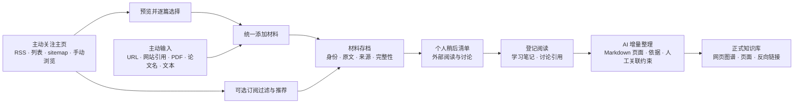

# 架构设计

> 当前架构见本文开头、ADR 0021 与后续语义调整 ADR 0022；M0–M12 的历史机制保留在后文。M13–M15 实施和未完成验收见 `docs/roadmap.md`。

## 目标（2026-11-17 调整）

以个人维护的信源、稍后阅读清单和知识库组织学习。阅读主要发生在原站、ChatGPT 等外部环境；本系统负责主动收集材料、记录学习结果，以及让 AI 增量维护可追溯、可编辑的知识网络。订阅过滤和时间预算推荐保留为辅助能力，不是主流程门槛。

## 数据流



## 核心边界

- **材料库**：PDF、URL、论文名检索结果、文本和订阅内容最终进入同一个材料接口；身份、去重、原文、来源和正文完整性不依赖信源配置、推荐评分或每日预算。输入来源不是材料身份，同一论文可从多个入口补全。
- **阅读与机器处理分离**：未读 / 阅读中 / 已读是用户阅读状态；提取、分析、编入 wiki 是处理状态；推荐状态属于可选推荐流程。三者独立，不把机器生成页面等同于用户已读或掌握。
- **知识整理**：可以显式选择任意材料编入 wiki，不必先点“有收获”或运行 L2。博客与论文共用知识整理能力；原文、机器整理与用户笔记可区分，生成过程保留来源，不覆盖个人内容。
- **存储归属**：SQLite 保存材料身份、导入来源、处理记录和运行状态；Markdown wiki 保存知识页面与页面链接。图谱及反向链接由 wiki 派生，不维护另一份可独立编辑的图数据；暂不引入图数据库。
- **Obsidian 兼容**：wiki 是普通 vault，可直接打开与编辑；页面链接、别名和资源使用兼容的 Markdown / wikilink。Web 与 Obsidian 读取同一批文件，不承诺两者布局完全一致；外部编辑需能重新索引。
- **图谱是入口，不是内容替代品**：全局图用于概览，局部图围绕当前材料或概念展示直接邻居并逐步展开；点击节点可查看完整页面、关联页面、反向链接和原文来源。布局、预览面板与点击手势不在架构层锁死。
- **链接含义**：普通边只表示页面有关联，不自动声称引用、因果或前置关系。具体关系先在页面内容中说明并附来源；模型推断须可辨认。是否引入有类型、有方向的边另行讨论，不作为本轮前提。

## 外部阅读与人工知识控制（ADR 0022）

- **信源**是长期关注的生产者，材料是具体内容。ADR 0023 将主页、目录、CLI/Web 预览统一到注册适配器；先匹配关注和完整参考规则，再通用发现，失败不覆盖配置。发现最多8请求、每请求3次重定向、每响应1MB、500链接、50候选；sitemap index 额外限制同源、深度2和6文档。公网逐跳检查，不执行脚本或绕过登录。确认关注不自动导入文章。
- **默认关注为空**：缺少正式 `sources.yaml` 不再订阅 example；参考目录折叠、可筛选，明确添加时才保存。已有正式文件及注释保持。信源中选中的文章记录 `item_sources.source_id`，但不借此进入推荐状态。
- **通用添加**覆盖 URL、只存引用的网站、PDF、文本和论文名。只存引用不请求原站；空正文的不同 URL 不因标题相同而合并。默认加入稍后清单，论文检索仍不使用 LLM。
- **清单独立**：schema v12 的 `reading_list(item_id, added_at)` 与推荐反馈分离；迁移仅接收最新仍为 `later` 的历史意图。加入/移出不生成反馈、不删除材料；普通偏好变化不取消已经登记的阅读事实。
- **登记阅读**由 CLI/Web 共用 `ops.register_read`：设置已读、移出清单、保留笔记/讨论引用并增量整理。讨论链接不抓取；无正文时可以只根据用户学习笔记整理，但明确标注，不补造原文内容。模型失败仍保留阅读事实、学习记录、材料和错误，知识库提供重试入口。
- **费用与复用**：输入指纹覆盖实际原文、完整性和学习笔记；相同输入复用已有整理，甚至无需初始化付费后端，显式 force 才重做。只给模型当前材料与有界相关上下文，不定期重写整库。沿用 `run.max_cost_usd` 预估/已记录用量限制，不把它描述为服务商账单硬上限。
- **正式与草稿**：未读时显式机器整理标为 draft，默认图、目录、已知知识和复习排除；登记阅读后提升为 recorded，不提升掌握度。原有无标记页面保留为 legacy，不推断掌握情况或重写用户页面。
- **人工跨域连接**：页面/CLI 支持 pin、block、reset 与原因，保存为 frontmatter `human_relations`，目标采用稳定 vault-relative 路径。固定关联追加可见的人工 wikilink；禁止关联双向过滤图/反向链接并约束后续机器追加。解除约束不恢复历史已抑制内容；个人正文和独立笔记保留。人工操作不调用 LLM。
- **Web 主入口**为信源、阅读列表、知识库、设置与管理；材料存档、推荐历史、旧分析作为次级入口。ADR 0022 的业务切换完成后，按用户确认的方案增加 shadcn/ui 风格视觉层；网页直接渲染图谱，不依赖 Obsidian。
- **跨端限制**：原生 Obsidian 不执行本系统的 draft/block 规则；共享 Markdown 不意味着两个图完全相同。此前 M14 的原生验收缺口保持，不再次启动触发钥匙串提示的实例。

## 来源身份、领域与参考目录（ADR 0023）

- `SourceConfig.name` 是可选显示名称；`id` 仍是材料来源身份。字段级 YAML 更新保留顺序和其他内容，来源编辑锁覆盖 CLI/Web 写入；ID 改名同步实际外键及来源元数据，数据库/文件失败时补偿恢复。采集修复保留人工字段，仅更新已验证适配和缺失名称。
- schema v13 新增 `source_analyses`（按来源保存输入指纹、模型分类与证据）及 `source_catalog_hidden`（仅候选显示偏好）。移除/清空目录不删除关注或底层规则，不能因隐藏目录让已知主页失去适配。
- 目录标签、文章历史主题只作有来源的免费提示，不冒充新推断；人工 tags 与 AI 分类独立。显式分类最多10份标题/摘要、24,000字符输入，cheap 输出最多1,024 tokens且不提高配置上限，费用预估覆盖校验重试；未知价格拒绝调用，用量/失败在 SOURCE 阶段记录。相同实际输入和提示词复用，失败保留旧分析，无内容证据拒绝猜测。详细取舍见 ADR 0023。


## Web 视觉与图谱工作区（2026-11-17）

- 保留 FastAPI/Jinja2/HTMX 与本地静态资源，不引入 React 或 shadcn 运行时。共享 CSS 定义中性色、表面/边框、主次按钮、表单、紧凑列表及焦点状态；导航固定在左侧，窄屏改为带 Escape/焦点管理的抽屉。
- `ui.js` 在样式加载前解析浏览器偏好；`light / dark / system` 存在 `localStorage.secondbrain-theme`，默认 system。解析后的主题写入根元素，并发送 `secondbrain:themechange`，Cytoscape 即时更新画布样式，不改应用配置或数据库。
- 添加材料的四类输入以渐进增强 tab 组织；各类本页草稿分开保留，包括文件选择。隐藏类型及不适用的学习记录字段禁用，避免切换后把旧输入混入提交。业务端点、字段和任务注册表不变。
- 图谱沿用 Markdown 派生 API，画布为主、右侧节点 inspector；移动端上下排列。借鉴 [Archify](https://github.com/tt-a1i/archify) 的聚焦探索/源依据，以及 [Graphify](https://github.com/Graphify-Labs/graphify) 的搜索筛选/详情交互；没有复制其代码或引入 MCP/托管服务。
- 使用连接度对数分层的 concentric 布局，避免力导向小图挤团；连接度不是语义社区。全局位置可恢复，局部范围显式改变时仅重新排列可见子图；选择、筛选和主题变化不重排。节点按类型着色/形状区分，标签省略与缩放降噪，选中及直接邻居高亮；完整名称和来源仍在 inspector/知识页。普通边含义、草稿过滤、人工关联约束不变。
- HTML 使用 `Cache-Control: no-store`；所有模板静态资源通过 `static_asset` 生成内容摘要 query 版本，静态响应（含304）使用 `no-cache`。摘要按文件元数据缓存并在变更后重算，避免无版本资源地址在浏览器/代理中把新 HTML 和旧 CSS/JS 混用；不是依靠前端框架解决资源发布一致性。


## M13 实现边界

- `items.id` 保留为材料身份；`source_id` 可空，仅作为可选推荐的主要信源。`item_sources` 记录每个输入的方式、定位、信源、提取方式、完整性和原文件，订阅和主动导入共用 `db.persist_material`。不以标题相似自动合并。
- `reading_state`（`unread / reading / read`）、`processing_status` 与原有推荐 `status` 分开；重复导入默认保留用户阅读状态。ADR 0022 进一步拆出独立稍后清单；显式整理不会生成读后反馈。
- 原 PDF 与提取文本保存到 vault 的 `resources/`，正文保留完整性和截断信息；摘要只标为摘要。wiki 使用实际可用正文，长文逐段提要后整理，不要求 L2，也不静默丢弃尾部。
- 每份材料的知识页使用 `pages/materials/material-<id>.md`；已有 paper 页保留。新概念为「陌生」，不设置 `last_reviewed`；仅因生成页面不进入「已知知识」信号。
- 机器整理保守追加、按内容去重，不替换用户文字。独立个人笔记保存在 `notes/material-<id>-notes.md`，避免与材料页同名；M14 迁移旧笔记路径、保留原字节并更新非代码引用。CLI/Web 共用；原文、机器内容与笔记各自可追溯。
- `sb add` 和 Web `/add` 接受无 URL 的 PDF/文本；`sb items show / read-state / notes` 与材料详情页支持阅读、状态和笔记；任意材料可用 `sb wiki ingest <id>` 整理为草稿。ADR 0022 将 `--pending` 改为已登记阅读但尚未完成整理的队列，不再以「有收获」作为条件。

## M14 实现边界与验收限制

- 首页以材料与网络为入口，推荐移到 `/recommendations`；ADR 0022 再按信源/阅读列表/知识库整理主导航。无 digest 不阻塞主流程。CLI `wiki show / graph / reindex` 与 Web 读取同一 vault。
- 图谱、反向链接、体检使用相同的 Markdown 解析和名称消歧。唯一文件名保留 ID；文件名碰撞用 vault-relative `.md` 路径。中文、别名、相对路径可解析，代码中的 wikilink 不生成边。缺失和歧义分别提示。
- 根目录及外部知识子目录页面可加入网络；raw、resources、notes、隐藏目录和 index/log 不作为知识节点。外部编辑后重建目录即可，不维护另一份图数据。
- Web 提供全局图、局部中心、直接邻居逐步展开、名称定位、详情与反向链接。普通边只表示链接，机器推断与来源说明仍放在正文。
- Markdown 经严格标签/属性/URL 白名单输出；KaTeX 离线渲染公式且 `trust:false`，不以兼容性为由允许不安全 HTML。
- Obsidian 实际阅读视图已观察到同一页面的公式、表格与代码；完整跨端图谱/资源/编辑联动验收因隔离实例触发钥匙串提示而停止。未重置钥匙串、不要求密码，不把未完成验收标记完成。

## M15 实现边界

- `papers.import_by_name` 和 `choose_candidate` 由 CLI/Web 共用；检索按有界的 Semantic Scholar、Crossref、arXiv、OpenAlex 和 USENIX 公开页面获取元数据，不调用 LLM、不增加依赖。
- 支持完整标题以及名称加作者/年份/会议描述；公开标识一致时可归并作者缩写/连字符等元数据差异，保留各 provider 记录。标题本身不能证明材料身份；不同作者/年份/标识或未能核对的候选必须选择，不因排序擅自导入。
- `paper_searches` 保存不可变候选及检索错误，`paper_import_attempts` 保存选择/导入结果；选择只接收保存的 ID，不接受客户端 URL，也不重跑查询改变候选。
- 正文提取与身份/原件/去重走 M13 的 `ops`/`db.persist_material`；只有摘要的响应作兜底，继续尝试已知正文地址。来源元数据保存请求/实际地址和版本；优先可明确重放的 arXiv 版本，不能确认的实际版本明确标 unknown。
- schema v11 增加来源 `metadata_json`、LLM 错误与 `usage_known`。未知用量不是已知零用量，错误仍持久保存；wiki 受现有 `run.max_cost_usd` 的预估和用量限制，失败不删除材料。不绕过付费墙、不执行资料中的本地命令。

## 历史机制（M0–M12，后续调整以上文为准）

下文记录 M0–M12 历史机制，不覆盖上述当前架构。特别是“有收获”队列、L2 输入依赖、旧反馈对 read_at 的清除语义和 digest 首页均已由后续阶段调整，不能作为现行主流程约束。

## 各层职责

| 层 | 职责 | 是否用 LLM |
|---|---|---|
| Sources | 读 `config/sources.yaml`：信源类型（rss / arxiv / hf_papers / youtube / sitemap，sitemap 见 ADR 0012）、地址 / 检索式、trust、role（core / expansion）、标签、时间窗、backfill | 否 |
| Ingest | 抓取（`net.py`：httpx，超时 / 重试 / 礼貌 UA / 按 host 限速；信源间线程池并发）、正文提取（HTML / PDF / 字幕）、URL 规范化 + content hash 去重（`urls.py`），由 `ingest.py` 编排写入 `items`；backfill 信源抓历史归档进补课池（M5）。见 ADR 0005 | 否 |
| L0 规则 | 时间窗、include / exclude 关键词、最短长度、已处理跳过 | 否 |
| L1 粗筛 | cheap 模型批量打分：`relevance / novelty / quality`、`content_type`、`refresher_value`、`topics[]` + 一句理由；结合 profile 掌握度：不扎实领域的好讲解加 refresher_value，扎实领域只推 frontier；分数 × trust 取 top-N | 是（判断） |
| L2 精读 | strong 模型读截断全文，输出中文 `tldr / key_points / why_for_you / scores`，以及 `est_minutes`（读懂并验证的时间）和 `prerequisites[]` | 是（判断 + 总结） |
| Tiering | 以 `daily_budget_minutes` 为主约束、各 lane 条数为上限，分到 `must_read / worth_it / refresher / serendipity / fyi / archived`；标记"深读"并可顺延；积压超期降级；允许为空 | 否 |
| Web UI | 本地 FastAPI + Jinja2 + HTMX：今日 digest（按 lane）、预算进度条、积压数量、est_minutes、前置知识提示、详情、历史、反馈按钮；稍后再看、运维（立即运行、用量、trust 建议）、信源管理、wiki 体检与知识图谱（M7） | 否 |
| Feedback | 文章反馈两组（读之前 / 读完后，ADR 0013），每条目只有一个当前状态；供 few-shot、profile 证据与 wiki 队列；M11 起不调整信源 trust；掌握度只在概念复习中调整 |
| Profile | 用户手写的 `profile.md`，含可解析的领域掌握度表；LLM 只提出修改 diff（含掌握度调整建议），用户确认后才写入 | 提案时用 |
| Wiki | "学了"的条目由 LLM 产出结构化页面操作、代码落盘；概念页记录 mastery 与复习间隔；`index.md` 作为已知知识注入 L1，到期概念进入温故栏 | 是（结构化输出） |

## 掌握度、温故与前置知识（ADR 0003）

- 掌握度四级：`陌生 / 接触过 / 想回炉（熟悉但不扎实）/ 扎实`。"熟悉"不等于"扎实"：只有"扎实"领域才降低入门讲解的权重。
- refresher lane 独立于 must_read，默认 1–2 条 / 天，来源：L1 中 refresher_value 高的 explainer / survey、M6 到期复习的概念（若有讲该概念的好文一起推）、M5 的经典回补池。
- L2 的 `prerequisites[]` 命中用户不扎实的概念时，UI 提示"建议先回炉：[[概念]]"。
- 复习调度（M6）：SM-2 简化版，按钮"还记得 / 模糊 / 忘了"调整 interval 与 mastery。

## 每日时间预算（ADR 0004）

- M8（ADR 0015）：深读条目（est > 预算 × deep_read_ratio）按速读时间 `deep_summary_minutes`（默认 15）占用预算，全文时间照常显示；速读时间也放不下时才顺延。`digests.budget_minutes` 记录占用的分钟数。

- `daily_budget_minutes`（默认 105）为主约束；`lanes` 中的条数为上限。
- 单条 `est_minutes` > 预算 × `deep_read_ratio`（默认 0.6）标"深读"，可顺延到预算有余的日子。
- 未读 must_read 计入积压并在 UI 显示；超过 `backlog_max_days`（默认 3）天降级到 fyi。

## 流水线细节（M2，见 ADR 0006）

**L0**（`pipeline/l0_rules.py`）：只处理 `items.status = new`；排除超出 `filter.l0.max_age_days`、正文短于 `min_content_chars`、标题 / 摘要命中 `exclude_keywords`（或 `include_keywords` 非空却未命中）的条目，排除原因写入 `assessments`（stage = L0）。

**L1 候选**：`sb run --limit N` 限制送入 L1 的条目数。按信源轮询选取（信源按 trust 降序，信源内由新到旧），避免高产信源占满名额。每批 `filter.l1.batch_size` 条，system 前缀为 profile + 规则，固定不变以利用缓存。

**排序分**（参数在 `filter.score`）：

```
score = (w_rel·relevance + w_q·quality + w_v·max(novelty, refresher_value)) / (w_rel + w_q + w_v)
        × (1 + trust_weight·(trust − 3))
```

默认 w_rel = 0.45、w_q = 0.30、w_v = 0.25、trust_weight = 0.1。`max(novelty, refresher_value)` 让条目因"新"或"值得回炉"都能得分。有 L2 结果时用 L2 的 scores，否则用 L1 的。

**L2 选择**（`filter.l1.top_n`，默认 15）：先预留意外栏候选（高质量且低相关，或 role = expansion，按 quality 取 `lanes.serendipity` 条）和温故栏候选（explainer / survey / tutorial 且 refresher_value ≥ 阈值，按 refresher_value 取 `lanes.refresher` 条），其余 core 条目按排序分补满。L2 前按字符数预估费用，若超过 `run.max_cost_usd` 则停止，不调用 L2、不分级。

**L2 输入**：论文（arXiv HTML / PDF）按标题切出 abstract + introduction + conclusion，每节不超过 `filter.l2.section_max_chars`；找不到章节或非论文时取正文开头；总长不超过 `filter.l2.max_input_chars`。

**分级**（`pipeline/tiering.py`，纯函数）：

- 只有经过 L2 的条目能进前排 lane（must_read / refresher / serendipity / worth_it）。
- 资格：refresher 类型（explainer / survey / tutorial、refresher_value ≥ 阈值且 ≥ novelty）只进温故栏，不占必读名额；否则 score ≥ `thresholds.must_read` 且 relevance ≥ `must_read_relevance` 可进必读；quality ≥ `serendipity_quality` 且 relevance ≤ `serendipity_max_relevance` 可进意外；score ≥ `worth_it` 可进值得读。role = expansion 的条目只能进意外栏。
- 预算分配：先放此前顺延的深读条目，再按 must_read → refresher → serendipity → worth_it 的顺序、分数从高到低填充；每条须放得进剩余预算，lane 条数不超过 `lanes`。
- 放不下的深读条目（est_minutes > 预算 × `deep_read_ratio`）记为 `deferred`，下次 run 优先；顺延超过 `backlog_max_days` 天不再顺延，进 fyi。放不下的非深读条目进 fyi。
- 其余条目 score ≥ `thresholds.fyi` 进 fyi，否则 archived。
- 积压：此前各日仍未读（`items.read_at` 为空；M7 起由读完后的四种反馈写入）、且当前状态不是稍后读 / 不感兴趣的 must_read，超过 `backlog_max_days` 天的改为 fyi；未超期的计入积压数。
- 预算预留（ADR 0007）：`lane_budget_reserve`（默认 refresher 15、serendipity 10 分钟）在分配开始时为有合格候选的温故 / 意外栏保留，must_read 与 worth_it 不能占用；该栏分配结束后未用完的额度释放回总预算。
- 同一天多次 `sb run` 共享当日预算：后一次 run 先扣除当天已占用的名额与时间（预期行为，不会每次 run 都重新给满 105 分钟）。digest 日期用本地日期，高峰计价用 UTC。

**未经 L2 的阅读时间估计**：`正文字符数 / estimate.chars_per_minute`，论文 × `paper_multiplier`，限制在 `[min_minutes, max_minutes]`。

**items.status**：`new → l0_rejected | l1 → l2 → tiered | deferred`；回补条目 `new → backfill_l1 → l2 → tiered | deferred`（没排上的回到 `backfill_l1`）。

## Web UI（M3）

- `web/app.py`（FastAPI + Jinja2，服务端渲染）：`/` 当天（或 `?date=`）digest，按 必读 / 温故 / 意外 / 值得读 / 顺延深读 / 速览（折叠）分组，顶部预算进度条（`data-budget="已排/预算"`）与积压数；`/item/{id}` 详情（L1 / L2 评分、key points、反馈历史）；`/history` 日期列表。
- 反馈：HTMX 按钮 `POST /feedback`（item_id、kind、可选 note），返回按钮组片段原地替换；kind 白名单，非法 400，条目不存在 404。M7 起为两组按钮，最新一次点击即当前状态，再点高亮按钮撤销（见下文"文章反馈与运维"）。
- "建议先回炉"：L2 的 `prerequisites` 中出现在用户掌握度为 陌生 / 接触过 / 想回炉 的领域（领域名或说明）里的概念单独提示（`profile/loader.weak_prerequisites`）。
- 前端资源 vendored 在 `web/static/`，不依赖 CDN：
  - HTMX 2.0.4，来源 `https://unpkg.com/htmx.org@2.0.4/dist/htmx.min.js`，sha256 `e209dda5c8235479f3166defc7750e1dbcd5a5c1808b7792fc2e6733768fb447`；
  - Cytoscape.js 3.34.4（M7），来源 `https://registry.npmjs.org/cytoscape/-/cytoscape-3.34.4.tgz` 中的 `package/dist/cytoscape.min.js`，sha256 `081591ab735b2b6a3b31a3c60f8f3a3e2fee8c92939e0c7820ad1208571b6cd8`，MIT。
- `sb serve` 默认只监听 127.0.0.1。
- 定时：`sb schedule install` 生成 launchd plist（`uv run sb run`，默认本地 07:00，按 UTC 检查是否高峰）。

## 个性化（M4，见 ADR 0008）

- `profile/feedback.py`：汇总近 `personalize.feedback_window_days` 天各条目的当前反馈（M7：不感兴趣 / 太浅 / 有收获 / 太难 / 没价值；含条目标题、信源、content_type、topics）。
- L1 system prompt = profile + 规则（固定前缀）+ "最近反馈样例"（M7：正例有收获、反例不感兴趣 / 没价值、校准样例太浅 / 太难，各最多 `few_shot_per_polarity` 条，无反馈时省略）；近期"太难"条目的前置知识放在 user 消息开头。
- `sb profile update`（与 Web `/profile` 共用 `profile/rewrite.py`）：strong 模型输出结构化提案（掌握度表的 update / add / remove，段落的 append / remove，每条带反馈 id 证据）→ 代码按规则校验（M7：升级需要太浅，有收获只能用于 陌生 → 接触过，降级需要太难，每次最多一级）→ 生成新文本与 unified diff；`--apply` 前备份到 `data/profile_history/`。反馈不足时不调用 LLM。LLM 用量记为 stage = PROFILE。
- `sb sources tune`（`profile/tune.py`）：M11 起只读，打印反馈分布、近期产出与低产出停用建议。反馈不再用来建议或修改 trust（ADR 0018）。

## 视频、长内容与回补（M5，见 ADR 0009）

- YouTube：频道 RSS → 字幕（youtube-transcript-api，失败退回 yt-dlp，只取字幕）→ 每约 30 秒一段、段首 `[mm:ss]` 的文本存入 `content`；时长取字幕末尾，存 `duration_seconds`。L0 排除 Shorts 与过短视频；无字幕视频只经 L1、不进 L2。视频要点带时间戳，展示时生成 `watch?v=ID&t=秒` 链接。
- 长内容：待读文本 > `filter.l2.mapreduce_threshold_chars` 时分块 → cheap 模型逐块提要（stage L2_MAP，prompt `l2_map_system.md`）→ strong 模型汇总（stage L2）。
- 按需精读：`sb deep` / Web "精读"按钮（`pipeline.run.deep_one`），只写 L2 评估、不改 digest。
- 回补：`backfill: true` 信源在 fetch 时把时间窗外的历史条目存为 `is_backfill = 1`；每次 run 在常规 L2 之后，从回补池（L1 粗筛后状态 `backfill_l1`）按优先级挑 `backfill.daily_limit` 条做 L2，分级时只能进温故栏，没排上的回到池中。

## 知识 wiki 与复习（M6，见 ADR 0010）

- 布局：`data/wiki/index.md`（代码重建）、`log.md`（只追加）、`pages/{concepts,entities,papers}/<slug>.md`（frontmatter + `[[slug]]`），原文在 `data/wiki/raw/<item_id>.md`（M7 起；页面链接 `../../raw/<id>.md`，lint / index / 图谱忽略 raw/）。
- ingest：条目 L2 结果 + 正文（长文只给要点）+ index + 相关页面 → strong 模型输出 `WikiPlan`（create，或 update 的 append_section / replace_section / add_links / add_aliases）→ 代码校验 slug 与路径、落盘、重建 index、追加 log（stage = WIKI）。
- 复习：SM-2 简化版（还记得 / 模糊 / 忘了，见 ADR 0010；M7 增加 需要回炉 / 已扎实），状态写在概念页 frontmatter。新概念页 mastery 从"接触过"起步（M7，不继承 profile）。
- 闭环：
  - 到期概念：作为只进温故栏的候选参与分级（est 5 分钟，`digest_concepts` 表，附近期相关条目）；
  - L1：user 消息开头附与本批相关的"已知知识"（system 前缀不变）；
  - 前置知识：匹配到不扎实的概念页时，"建议先回炉"链接到 wiki。

## 文章反馈与运维（M7，见 ADR 0013）

- 反馈两组：
  - 读之前：`later` 稍后读、`dismiss` 不感兴趣；
  - 读完后：`too_easy` 太浅、`gained` 有收获、`too_hard` 太难、`worthless` 没价值。
- 条目的当前状态 = 最新一条 feedback（`clear` = 撤销）。读完后四种写 `read_at`，其余清空 `read_at`。`/later` 列出当前为稍后读的条目。
- `ops.py`：`run_once`（与 `sb run` 相同，持有 `data/run.lock` 的非阻塞 `fcntl.flock`）、`ingest_items`，由 CLI 与 Web 共用（M11 起不再有 `apply_trust`）。
- `web/tasks.py`：后台线程任务，同类只跑一个；状态片段 `GET /tasks/<kind>` 每 2 秒轮询。
- 页面：
  - `/`："待编进 wiki" 按钮；
  - `/ops`：用量、立即运行、trust 建议；
  - `/sources`：列表、试抓、添加、启停、删除确认；写 `config/sources.yaml`（M11 起按文本块编辑，保留注释，见 ADR 0018）；
  - `/wiki`：体检按钮；
  - `/wiki/graph` 与 `/wiki/graph.json`：节点 = 页面，边 = 已存在页面间的 wikilink。

## html_index 与论文导入增强（M12，见 ADR 0020）

- `html_index` 信源：
  - 解析列表页链接（`url_pattern` 匹配绝对地址，可选 `max_links`）；
  - 发布时间：列表页结构化日期 > 正文页 meta > 未知；
  - 主页兜底为列表页本身。
- 信源目录每个条目都有明确的 `homepage`。
- 手动导入的正文来源：
  - 网页：`citation_pdf_url` 的 PDF 优先，citation_* 补元数据；
  - DOI：Semantic Scholar → Crossref；
  - arXiv：API（含 `arxiv:doi`）+ arxiv_html / pdf。
- HttpClient 遵守 `Retry-After`（上限 `fetch.retry_after_max_seconds`），可附加请求头；可选的 `S2_API_KEY` 作为 `x-api-key` 发送。
- 跨标识去重：`items.doi` / `items.arxiv_id`（schema v9），查重顺序为规范 URL → DOI → arXiv id。
- "正文不完整"判定见 `db.INCOMPLETE_SQL`。

## 信源手动维护与手动添加文章（M11，见 ADR 0018）

- 反馈只影响 AI 判断：画像、few-shot、画像修改提案。trust 由用户手动设置；`/sources` 显示各信源的反馈分布，只供参考。低产出停用建议保留，它只看产出。
- `sources_file.py`：按条目文本块追加 / 删除 / 改 `enabled`，保留注释，写入前重新解析校验，原子写。支持 `sources: []`。
- 信源目录：example 中不在当前配置里的条目，可以预览（只解析、不写库）或原样追加（含注释）。
- 没有启用的信源时，`sb fetch` / `sb run` / 首页只给出提示，不抓取、不调用 LLM。
- 手动添加（`sb add`、`/add`，`ops.add_manual`）：
  - 条目归到虚拟信源 `manual`（DB 有 sources 行，enabled = 0，不在 sources.yaml 中），状态为 `manual`，不进 L1 / L2 / 分级 / 预算；
  - 已存在的条目只更新状态与反馈；
  - 准备读 = `later` 反馈，已读 = 读后反馈，已读但未评价时只设置 `read_at`；
  - 含 DOI 的链接先查 Semantic Scholar（有 arXiv 时走 arXiv，有开放获取 PDF 时用 PDF，否则只导入标题 + 摘要）；抓取失败时给出具体原因，可以用粘贴的正文或上传的 PDF 兜底（ADR 0019）。
- RSS 信源主页：配置 > 已记录的 channel link > feed URL 的站点根（托管域名除外）。

## 筛选、信源主页与运维设置（M10，见 ADR 0017）

- 首页与 `/history` 的 `?form=&ctype=` 筛选：
  - 形式由 `web/filters.item_form` 推导（paper / video / blog），类型取 L1 的 content_type；
  - 只影响显示，不改预算与 digest。
- 信源主页：
  - 配置的 `homepage` 优先，否则按类型推导；rss 的 channel `<link>` 在抓取时存入 `sources.homepage`（schema v8）；
  - 只输出 http(s) 链接。
- 配置读取：`settings.yaml` 深合并覆盖在 example 之上；`SB_CONFIG_DIR` / `SB_ENV_FILE` 可覆盖路径。
- `/ops` 设置区：
  - API key：只显示状态与来源；写入 `.env` 时原子写、chmod 600，并更新 `os.environ`；
  - 测试连接：stage PING；
  - 模型 / 后端：只把与 example 不同的键写入 settings.yaml。
- 安全 middleware：Host 白名单（本机地址 + `serve --host`）；修改类请求要求 Origin / Referer 同源（两者都没有时放行）。

## 手动运行与信源产出率（M9，见 ADR 0016）

- 运行方式：LaunchAgent 已安装 = 每日自动，否则手动。
  - `schedule.status / install / uninstall` 由 CLI 与 `/ops` 共用；`SB_LAUNCH_AGENTS_DIR` 可覆盖目录。
  - 有运行在进行时（run.lock 被占用）拒绝改为手动。
- 首页按"今天是否已有 digest"决定状态：
  - 没有：显示"开始今日过滤"（后台任务，完成后 `HX-Refresh`）；
  - 锁被占用：显示"正在运行"；
  - 已有：显示"再运行一次"入口。
- 不限时间窗（`--all-time`）：`ingest.collect` 不截断（仍每源 fetch_limit 条），`run_pipeline(all_time=True)` 让 L0 对新条目 ignore_age。
- 首页的速览与归档折叠为 `<details>`。
- 信源产出率：`db.source_yield` 与 `profile/tune.source_yields`，统计窗口 `personalize.yield_window_days`。
  - 低产出 = 启用、历史覆盖整个窗口、窗口内入库 ≥ `low_yield_min_items`、前排为 0。

## 深度速读与补前置（M8，见 ADR 0015）

- `pipeline/summary.py`：按需的深度速读。
  - 读全文（论文也不截取章节，上限 `summary.max_total_chars`）；超过 `summary.single_max_chars` 时 cheap 分块提要（SUMMARY_MAP）→ strong 汇总（SUMMARY）。
  - 输出 `DeepSummary`：问题与动机、核心方法、关键结果、局限、与已有知识的关系（输入为 profile + `known_knowledge`）、值得精读的章节、前置知识。
  - 缓存在 `item_ai`（kind = summary），不影响分级。
- 补前置：有深度速读时只用速读的前置知识，否则用 L2 的；名字按小写、去首尾空白、去末尾复数 s 去重。
  - wiki 已有的给出链接与掌握度；
  - 没有的用一次 strong 调用（PREREQ）批量生成讲解，缓存为 kind = prereq；
  - 列出库中讲解类条目；
  - "存为概念页"不调用 LLM。
- 入口：
  - CLI：`sb summary` / `sb prereq`；
  - Web：item 页与深读卡片上的"深度速读"按钮（后台任务）、item 页的"补前置"按钮（同步）。
- 编排都在 `ops.py`，CLI 与 Web 共用。按钮旁的费用由 `web/app.CostHints` 按当前模型价格估算。

## 数据模型草案

存储：SQLite 单文件 `data/brain.db`；wiki 为 `data/wiki/` 下的 Markdown。字段为草案，以实现时的 `db.py` 为准（M1 实现 `sources`、`items`，M2 实现 `assessments`、`digests`、`llm_calls`，M3 实现 `feedback` 与 `items.read_at`；schema 版本记录在 `PRAGMA user_version`）。

| 表 | 主要字段 | 引入 |
|---|---|---|
| `sources` | `id`, `type`, `url` / `query`, `trust`, `role`（core / expansion）, `tags`, `max_age_days`, `enabled`, `backfill`；`last_fetch_at / status / added / message`（最近一次抓取，M7）；`homepage`（feed 中读到的主页，M10） | M1（`last_fetch_*` M7 v6，`homepage` M10 v8） |
| `items`（M11：`status = manual` 为手动添加，不进流水线） | `id`, `source_id`, `url`, `url_canonical`（唯一）, `content_hash`, `title`, `author`, `summary`, `content`, `extract_method`（feed / html / arxiv_html / pdf / summary / none / transcript / transcript_ytdlp / no_transcript）, `published_at`, `fetched_at`, `status`, `read_at`, `is_backfill`, `duration_seconds`, `doi`, `arxiv_id` | M1（`read_at` M3，`is_backfill` / `duration_seconds` M5，`doi` / `arxiv_id` M12 v9） |
| `assessments` | `id`, `item_id`, `stage`（L0 / L1 / L2）, `model`, `data`（JSON：L0 `reason`；L1 `relevance / novelty / quality / content_type / refresher_value / topics / one_line_reason`；L2 `tldr / key_points / why_for_you / est_minutes / prerequisites / scores`）, `score`（排序分）, `created_at` | M2 |
| `digests` | `date`（本地日期）, `item_id`, `lane`（must_read / worth_it / refresher / serendipity / fyi / archived / deferred）, `rank`, `est_minutes`（全文）, `budget_minutes`（占用预算，M8）, `is_deep_read`, `deferred_from`（首次顺延日期）, `created_at`；`(date, item_id)` 唯一 | M2（`budget_minutes` M8，schema v7） |
| `item_ai` | `item_id`, `kind`（summary / prereq）, `data`（JSON）, `model`, `created_at`；`(item_id, kind)` 唯一 | M8 |
| `feedback` | `id`, `item_id`, `kind`（M7：later / dismiss / too_easy / gained / too_hard / worthless / clear）, `note`, `ts`；每个条目最新一条为当前状态；读完后四种写 `items.read_at` | M3（kind 取值 M7 修订） |
| `wiki_ingests` | `item_id`（主键）, `ts`, `pages`（JSON：新建 / 更新的 slug） | M6 |
| `digest_concepts` | `date`, `slug`, `title`, `mastery`, `est_minutes`, `related_item_id`, `created_at`；`(date, slug)` 唯一 | M6 |
| `llm_calls` | `id`, `ts`, `backend`, `stage`（L1 / L2 / L2_MAP / PROFILE / WIKI / SUMMARY / SUMMARY_MAP / PREREQ / PING）, `model`, `prompt_tokens`, `cache_hit_tokens`, `cache_miss_tokens`, `completion_tokens`, `cost_usd`（按 config 价格估算，非高峰 × `off_peak_multiplier`）, `is_peak` | M2 |

Wiki 概念页 frontmatter（M6）：`mastery`、`last_reviewed`、`interval_days`、`ease`（SM-2 简化版）、`sources`（来源条目）。

## LLM 后端

统一接口（M2）：`complete_json(messages, schema, tier="cheap"|"strong") -> (obj, usage)`，以及 `ping()`（M10，测试连接）。默认 DeepSeek（OpenAI 兼容），`fake` 后端用于离线测试。模型名、价格、预算与配额都写在 settings 中（`config/settings.yaml` 深合并覆盖在 example 之上，M10），便于更换。见 ADR 0002。

- 模型分工：cheap 用于 L1 粗筛与长内容分块提要（L2_MAP）；strong 用于 L2 精读、按需精读、wiki ingest、profile 修改提案。两级机制保留，默认两级都用 `deepseek-flash`（ADR 0014）；在 `llm.models.strong` 中可改回 `deepseek-v4-pro`。

- DeepSeek（`llm/deepseek.py`）：openai SDK，`response_format={"type": "json_object"}`，prompt 中含 json 示例；网络错误 / 429 / 5xx 由 SDK 指数退避重试（`llm.max_retries`）；输出用 pydantic 校验，失败重试一次；错误信息中的密钥被替换为 `***`。
- fake（`llm/fake.py`）：按标题关键词（内置 AI infra 关键词 ∪ profile 中的英文词）与标题哈希确定性打分，离线全链路可产出各 lane。
- 输出健壮性（ADR 0011）：推理模型（如 deepseek-v4-pro）的推理 token 计入 `max_tokens`（strong 默认 8192，对 flash 同样适用）；校验失败时重试一次，截断（finish_reason = length）时 `max_tokens` 翻倍（上限 `max_tokens_cap`），并把字段路径级的错误反馈给模型；WikiPlan 宽容解析，单个非法操作只丢弃该操作。
- prompts 在 `src/secondbrain/llm/prompts/*.md`，`{profile}` 与 `{mastery}` 在运行时替换；掌握度表解析失败时提示模型直接参考画像全文。

## 借鉴的原则

- **确定性预过滤**：能用规则解决的（时间窗、关键词、长度、去重）不花 token。
- **LLM 只做判断**：抓取、去重、排序、分级、落盘都是确定性代码；LLM 只输出结构化的打分、理由、估时和总结。
- **推荐必带理由**：每条推荐都有 `one_line_reason` / `why_for_you`，可解释、可反馈。
- **允许空**：某天没有值得推荐的内容就不推，配额与预算是上限而不是目标。
- **意外名额**：保留少量"高质量但低相关"的名额（`lanes.serendipity`，候选含 `role: expansion` 信源），防止信息茧房。
- **熟悉 ≠ 掌握**：不扎实的基础知识值得回炉，用独立的温故栏承载，不与新进展抢名额。
